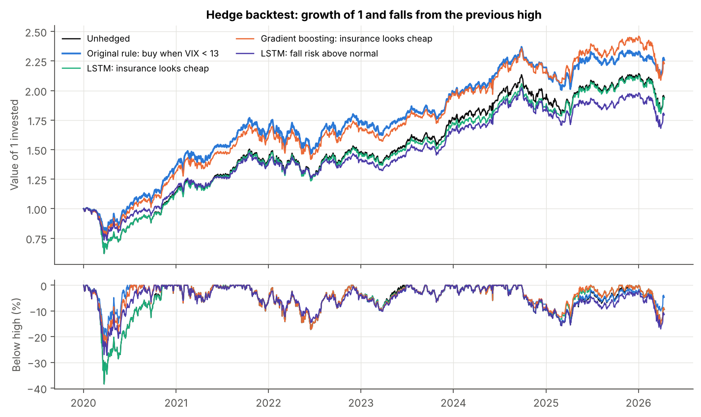

# Machine learning and India VIX: can a model time crash insurance better than VIX?

FDRM course project by **Group 8**, IIT Jodhpur. An extension of our India VIX hedging project ([app](https://subham-fdrm-vix.streamlit.app), [code](https://github.com/Subham1709/FDRM_VIX)).

**Live app:** *(add the Streamlit link here once deployed)*

In the main project, a Nifty 50 portfolio bought a 3-month put 5% below the market only when India VIX was below 13, and sold it into volatility spikes. Here we ask whether machine learning (gradient boosting) and deep learning (an LSTM) can do better, in two ways:

1. **Forecast next month's volatility** better than VIX does, and buy the put when the forecast says insurance is cheap (forecast volatility at least equal to VIX).
2. **Predict a 7% fall in Nifty within three months**, and buy the put when that risk is above its usual level.

Every forecast is made walk-forward: on the first trading day of each month the models are retrained on earlier data only, with a gap so that no training answer reaches past the forecast date. Nifty data from 2007 gives twelve years of training before the test starts in January 2020. The hedge backtest uses the original project's option pricing and trading rules unchanged (the engine reproduces the original rule's figures exactly).



## Main findings

| | Result |
| --- | --- |
| Volatility forecasts | From 2022 the LSTM's average error was 3.3 volatility points against 3.8 for VIX (VIX runs about 2 points too high: the volatility risk premium). A plain HAR regression with VIX did as well (3.3). Gradient boosting did not beat VIX. No difference is statistically significant (Diebold-Mariano t below 2). |
| Predicting falls | No model ranks risky days much better than chance: AUC 0.56 for gradient boosting, 0.60 for the LSTM, 0.62 for a one-variable logistic regression on recent volatility (0.5 is guessing). A model trained on VIX in 2020-21 learned "high VIX comes before falls" and was wrong afterwards (AUC 0.23): later falls started from calm markets. |
| Timing the hedge | The original VIX < 13 rule returned 13.9% a year (worst fall −22%). The best pre-set ML rule, gradient boosting "insurance looks cheap", returned 13.6% (−25%). The LSTM version missed the COVID crash and matched no hedge (11.0%). Rules based on fall risk did worse than no hedge. |
| Fragility | Moving the "cheap" threshold by 0.05 changes returns by up to 4 points, because one put more or less in early 2020 decides the result. From July 2020 the original rule and both "cheap insurance" rules are within about half a point a year of holding Nifty with no protection, and buying on fall risk cost 2 to 3 points a year. |

**Conclusion.** Machine learning gave slightly better volatility forecasts but no reliable improvement in timing the insurance. The cheapness of insurance read directly from VIX, which the original rule uses, matters more than trying to forecast the next crash.

| Strategy (Jan 2020 to Apr 2026) | Return a year | Volatility | Sharpe | Worst fall | Insurance cost a year | Puts bought |
| --- | --- | --- | --- | --- | --- | --- |
| Unhedged | 11.1% | 18.3% | 0.25 | −38.4% | 0 | 0 |
| **Original rule: buy when VIX < 13** | **13.9%** | **15.4%** | **0.48** | **−22.0%** | **−2.2%** | **22** |
| Buy every month | 8.8% | 13.6% | 0.17 | −25.5% | 2.2% | 73 |
| Gradient boosting: insurance looks cheap | 13.6% | 16.1% | 0.44 | −24.9% | −2.0% | 9 |
| LSTM: insurance looks cheap | 11.0% | 18.1% | 0.25 | −38.4% | 0.1% | 5 |
| Gradient boosting: fall risk above normal | 8.1% | 16.5% | 0.10 | −38.4% | 2.8% | 33 |
| LSTM: fall risk above normal | 9.8% | 14.9% | 0.22 | −27.3% | 1.4% | 34 |
| VIX < 13 or LSTM insurance cheap | 14.2% | 15.3% | 0.50 | −22.0% | −2.4% | 25 |

All strategies sell half the put when VIX reaches 22 and the rest when VIX falls 20% from its peak. A negative insurance cost means the puts earned more than they cost. The last row combines the original rule with one of the four ML rules, so its small lead over the original rule should not be read as an improvement.

## How to run it

```bash
pip install -r requirements.txt
python forecast.py      # walk-forward forecasts, about 3 to 10 minutes on a laptop CPU (mostly the LSTM)
python backtest.py      # hedge backtests, a few seconds
python figures.py       # charts
streamlit run app/streamlit_app.py
```

`python forecast.py --no-lstm` re-runs everything except the LSTM in under a minute and keeps the saved LSTM forecasts. The web app needs only `app/requirements.txt` and reads the saved files in `output/`; it does not retrain the models.

## What's in the repo

| Path | Contents |
| --- | --- |
| `src/features.py` | Loads the data; builds 15 Nifty features and 5 India VIX features known at each close, and the two targets |
| `src/models.py` | The walk-forward loop and the benchmark, logistic and gradient boosting (LightGBM) models |
| `src/lstm.py` | The LSTM (PyTorch): reads 63 days of features, predicts volatility and the chance of a fall together |
| `src/engine.py` | The put-hedge backtest, ported from the original project |
| `forecast.py`, `backtest.py`, `figures.py` | The three steps above |
| `app/streamlit_app.py` | The web app, including a tab where you build and backtest your own rule |
| `output/` | `predictions.csv` (every model's forecast for every day), accuracy tables, backtest results, every option trade, threshold sensitivity, `summary.json` |
| `figures/` | Five charts |
| `docs/fdrm_vix_ml_summary.pdf` | Short written summary |
| `data/` | Nifty 50 (from Sep 2007) and India VIX (from Jan 2020) daily data, the same files as the main project |

## Models

| Task | Benchmarks | Machine learning | Deep learning |
| --- | --- | --- | --- |
| Next-month volatility | India VIX; last month's volatility; HAR regression; HAR + VIX | Gradient boosting (Nifty features; Nifty + VIX features) | LSTM, 32 units, Nifty features |
| 7% fall within 3 months | Long-run base rate; logistic regression on recent volatility, on VIX, on all features | Gradient boosting (both feature sets) | Same LSTM, second output |

Model settings were fixed before testing. Gradient boosting: 300 to 400 trees with 8 leaves, learning rate 0.03. LSTM: one layer, dropout 0.2, Adam, early stopping on the latest 15% of the training data, retrained every 3 months, averaged over 3 random seeds.

## Limitations

- Option prices are modelled with Black-Scholes from India VIX, not taken from real trades (as in the main project).
- India VIX starts in 2020, so models that use it have only one to four years of training data.
- Six years with one true crash: any comparison of hedging rules rests on a handful of buying decisions, and overlapping 3-month windows hold far fewer independent observations than the 1,500 test days suggest.
- Trades at the daily close on the same day the forecast is made, as in the original project.
